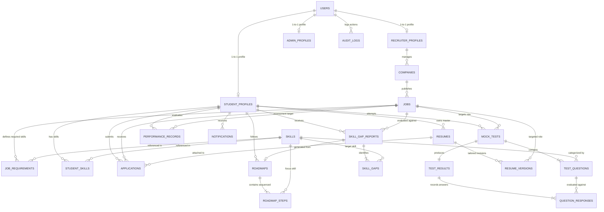

# ASPIRE — MongoDB Atlas Database Architecture

This document specifies the complete, production-grade MongoDB schema architecture, validation rules, indexing strategy, relationship references, and initialization procedures for **ASPIRE (AI-Powered Student Placement and Career Intelligence Platform)**.

---

## 1. Architectural Overview & Design Philosophy

ASPIRE's database architecture is built specifically for **MongoDB Atlas** using a normalized reference architecture with explicit document schemas and indexing.

### Key Principles
1. **Document Integrity via `$jsonSchema`**: Every collection is strictly guarded by server-side MongoDB JSON Schema validation enforcing required fields, BSON data types, numeric ranges (e.g. CGPA $\in [0, 10]$, percentage $\in [0, 100]$), and enumerated values.
2. **Normalized References vs SQL Foreign Keys**: Documents link to one another using standard MongoDB `ObjectId` references (`_id`). MongoDB does not enforce cascading constraints automatically; application integrity and data lifecycles are maintained via explicit reference definitions.
3. **Strict Eligibility & Scoring Separation**: Academic eligibility criteria (such as minimum CGPA, department, degree, and graduation year) remain separate from AI skill-matching algorithms. Unknown eligibility criteria remain `null` / `unknown` rather than assumed satisfied.
4. **Security & Data Confidentiality**:
   - Test questions separate question delivery from answer-key validation.
   - Audit logs capture transactional operations without ever recording passwords, tokens, or credentials.
   - Resumes preserve historical versions alongside the master profile.

---

## 2. Entity Relationship Diagram (ERD)



---

## 3. Collections & Schema Reference

The database comprises **20 core collections** organized into 10 functional domains.

### A. User & Role Management

#### 1. `users`
Central identity collection for authentication and core role management.
- **Fields:**
  - `_id` (`ObjectId`): Unique user identifier.
  - `name` (`string`): User full name.
  - `email` (`string`): Unique institutional or personal email address (regex-validated).
  - `password_hash` (`string`): Cryptographic password hash.
  - `role` (`string`): Enum: `["student", "recruiter", "admin"]`.
  - `is_active` (`bool`): Account active status flag.
  - `created_at` (`date`): Account creation timestamp.
  - `updated_at` (`date`): Last modification timestamp.
- **Indexes:**
  - `idx_users_email_unique` (`email: 1`, **unique**)
  - `idx_users_role_active` (`role: 1, is_active: 1`)

#### 2. `student_profiles`
Academic records and profile details for student users.
- **Fields:**
  - `_id` (`ObjectId`): Profile identifier.
  - `user_id` (`ObjectId`): Reference to `users._id`.
  - `register_number` (`string`): Unique institutional registration number.
  - `department` (`string`): Academic department (e.g. `Computer Science and Engineering`).
  - `degree` (`string`): Degree title (e.g. `B.Tech`, `M.Tech`).
  - `graduation_year` (`int`): Passing out year ($1990 \le year \le 2100$).
  - `cgpa` (`double`/`int`): Cumulative GPA on a 10-point scale ($0.0 \le CGPA \le 10.0$).
  - `profile_summary` (`string`, optional): Student biography or personal statement.
  - `created_at` (`date`): Timestamp.
  - `updated_at` (`date`): Timestamp.
- **Indexes:**
  - `idx_student_profiles_user_id_unique` (`user_id: 1`, **unique**)
  - `idx_student_profiles_reg_no_unique` (`register_number: 1`, **unique**)
  - `idx_student_profiles_academic_filter` (`department: 1, degree: 1, graduation_year: 1`)
  - `idx_student_profiles_cgpa` (`cgpa: 1`)

#### 3. `recruiter_profiles`
Corporate recruiter profile records.
- **Fields:**
  - `_id` (`ObjectId`): Profile identifier.
  - `user_id` (`ObjectId`): Reference to `users._id`.
  - `designation` (`string`): Corporate role/title.
  - `organization_email` (`string`): Official corporate email.
  - `verified` (`bool`): Verification badge flag.
  - `created_at` (`date`): Timestamp.
  - `updated_at` (`date`): Timestamp.
- **Indexes:**
  - `idx_recruiter_profiles_user_id_unique` (`user_id: 1`, **unique**)
  - `idx_recruiter_profiles_org_email` (`organization_email: 1`)
  - `idx_recruiter_profiles_verified` (`verified: 1`)

#### 4. `admin_profiles`
Administrative configuration and permissions.
- **Fields:**
  - `_id` (`ObjectId`): Profile identifier.
  - `user_id` (`ObjectId`): Reference to `users._id`.
  - `permissions` (`array` of `string`): System access grants.
  - `created_at` (`date`): Timestamp.
  - `updated_at` (`date`): Timestamp.
- **Indexes:**
  - `idx_admin_profiles_user_id_unique` (`user_id: 1`, **unique**)

---

### B. Companies & Jobs

#### 5. `companies`
Organization profiles publishing placements or job opportunities.
- **Fields:**
  - `_id` (`ObjectId`): Company identifier.
  - `name` (`string`): Company legal/brand name.
  - `website` (`string`, optional): Corporate URL.
  - `industry` (`string`): Sector classification.
  - `description` (`string`): Company description.
  - `recruiter_id` (`ObjectId`): Reference to managing `recruiter_profiles._id` (or `users._id`).
  - `created_at` (`date`): Timestamp.
  - `updated_at` (`date`): Timestamp.
- **Indexes:**
  - `idx_companies_name` (`name: 1`)
  - `idx_companies_recruiter_id` (`recruiter_id: 1`)
  - `idx_companies_industry` (`industry: 1`)

#### 6. `jobs`
Job postings, internships, and placement listings with explicit eligibility criteria.
- **Fields:**
  - `_id` (`ObjectId`): Job identifier.
  - `company_id` (`ObjectId`): Reference to `companies._id`.
  - `title` (`string`): Role title.
  - `description` (`string`): Detailed job specifications.
  - `location` (`string`): Work location or Remote tag.
  - `employment_type` (`string`): Enum: `["full_time", "part_time", "internship", "contract"]`.
  - `min_cgpa` (`double`/`int`/`null`): Cutoff minimum CGPA ($0.0 \le CGPA \le 10.0$ or `null` if unspecified).
  - `eligible_departments` (`array` of `string`): Permitted academic departments.
  - `eligible_degrees` (`array` of `string`): Permitted degrees.
  - `graduation_years` (`array` of `int`): Target batch graduation years.
  - `required_skills` (`array` of `string`/`ObjectId`): Core required skills.
  - `preferred_skills` (`array` of `string`/`ObjectId`): Preferred bonus skills.
  - `package_details` (`object`/`string`/`null`): Compensation details (CTC, base salary, stipend).
  - `application_url` (`string`, optional): Portal or external application URL.
  - `deadline` (`date`/`null`): Application closing deadline.
  - `status` (`string`): Enum: `["draft", "published", "closed", "archived"]`.
  - `source_name` (`string`): Ingestion source (e.g. `Campus Placement`, `Career Portal`).
  - `source_url` (`string`, optional): Source listing link.
  - `created_at` (`date`): Timestamp.
  - `updated_at` (`date`): Timestamp.
- **Indexes:**
  - `idx_jobs_company_id` (`company_id: 1`)
  - `idx_jobs_status_deadline` (`status: 1, deadline: 1`)
  - `idx_jobs_dept_status` (`eligible_departments: 1, status: 1`)
  - `idx_jobs_grad_years_status` (`graduation_years: 1, status: 1`)
  - `idx_jobs_min_cgpa` (`min_cgpa: 1`)
  - `idx_jobs_created_at_desc` (`created_at: -1`)

---

### C. Skills & Job Requirements

#### 7. `skills`
Master ontology of skills and competencies.
- **Fields:**
  - `_id` (`ObjectId`): Skill identifier.
  - `name` (`string`): Unique canonical skill name.
  - `category` (`string`): Category classification.
  - `description` (`string`, optional): Skill summary.
  - `created_at` (`date`): Timestamp.
- **Indexes:**
  - `idx_skills_name_unique` (`name: 1`, **unique**)
  - `idx_skills_category` (`category: 1`)

#### 8. `student_skills`
Student-specific verified or self-reported competencies.
- **Fields:**
  - `_id` (`ObjectId`): Record identifier.
  - `student_id` (`ObjectId`): Reference to `student_profiles._id`.
  - `skill_id` (`ObjectId`): Reference to `skills._id`.
  - `proficiency` (`string`): Enum: `["beginner", "intermediate", "advanced", "expert"]`.
  - `evidence` (`object`/`string`/`null`): Projects, certificates, or assessment artifacts.
  - `updated_at` (`date`): Timestamp.
- **Indexes:**
  - `idx_student_skills_unique_pair` (`student_id: 1, skill_id: 1`, **unique**)
  - `idx_student_skills_student_id` (`student_id: 1`)
  - `idx_student_skills_skill_id` (`skill_id: 1`)

#### 9. `job_requirements`
Skill expectations mapped to individual job postings.
- **Fields:**
  - `_id` (`ObjectId`): Record identifier.
  - `job_id` (`ObjectId`): Reference to `jobs._id`.
  - `skill_id` (`ObjectId`): Reference to `skills._id`.
  - `importance` (`string`): Enum: `["critical", "high", "medium", "low"]`.
  - `mandatory` (`bool`): Strict prerequisite flag.
  - `minimum_proficiency` (`string`): Enum: `["beginner", "intermediate", "advanced", "expert"]`.
  - `created_at` (`date`): Timestamp.
- **Indexes:**
  - `idx_job_requirements_unique_pair` (`job_id: 1, skill_id: 1`, **unique**)
  - `idx_job_requirements_mandatory` (`job_id: 1, mandatory: 1`)
  - `idx_job_requirements_skill_id` (`skill_id: 1`)

---

### D. Applications

#### 10. `applications`
Placement applications submitted by students for specific job openings.
- **Fields:**
  - `_id` (`ObjectId`): Application identifier.
  - `student_id` (`ObjectId`): Reference to `student_profiles._id`.
  - `job_id` (`ObjectId`): Reference to `jobs._id`.
  - `resume_id` (`ObjectId`/`null`): Reference to `resumes._id` or `resume_versions._id`.
  - `applied_at` (`date`): Application submission timestamp.
  - `status` (`string`): Enum: `["applied", "in_review", "shortlisted", "assessment_scheduled", "interview_scheduled", "offered", "rejected", "withdrawn"]`.
  - `source` (`string`): Channel (e.g. `direct`, `portal`, `referral`).
  - `notes` (`string`/`null`): Application notes.
  - `created_at` (`date`): Timestamp.
  - `updated_at` (`date`): Timestamp.
- **Indexes:**
  - `idx_applications_student_job_unique` (`student_id: 1, job_id: 1`, **unique** — prevents duplicate applications)
  - `idx_applications_student_status` (`student_id: 1, status: 1`)
  - `idx_applications_job_status` (`job_id: 1, status: 1`)
  - `idx_applications_applied_at_desc` (`applied_at: -1`)

---

### E. Mock Tests & Results

#### 11. `mock_tests`
Practice assessment sessions generated for roles or skill areas.
- **Fields:**
  - `_id` (`ObjectId`): Test session identifier.
  - `student_id` (`ObjectId`): Reference to `student_profiles._id`.
  - `job_id` (`ObjectId`/`null`): Reference to target `jobs._id`.
  - `title` (`string`): Test title.
  - `difficulty` (`string`): Enum: `["beginner", "intermediate", "advanced", "mixed"]`.
  - `status` (`string`): Enum: `["created", "in_progress", "completed", "abandoned"]`.
  - `started_at` (`date`/`null`): Start timestamp.
  - `completed_at` (`date`/`null`): Completion timestamp.
  - `created_at` (`date`): Timestamp.
- **Indexes:**
  - `idx_mock_tests_student_created` (`student_id: 1, created_at: -1`)
  - `idx_mock_tests_job_id` (`job_id: 1`)
  - `idx_mock_tests_status` (`status: 1`)

#### 12. `test_questions`
Individual assessment questions. Correct answers are kept secure.
- **Fields:**
  - `_id` (`ObjectId`): Question identifier.
  - `mock_test_id` (`ObjectId`): Reference to `mock_tests._id`.
  - `skill_id` (`ObjectId`): Reference to `skills._id`.
  - `question_text` (`string`): Problem statement.
  - `question_type` (`string`): Enum: `["single_choice", "multiple_choice", "coding", "short_answer"]`.
  - `options` (`array` of `{ id, text }`): Option choices.
  - `correct_answer` (`string`/`array`/`object`): **Protected answer key** (filtered out in student-facing test delivery queries).
  - `explanation` (`string`/`null`): Solution explanation.
  - `marks` (`double`/`int`): Question weight ($\ge 0$).
  - `created_at` (`date`): Timestamp.
- **Indexes:**
  - `idx_test_questions_mock_test_id` (`mock_test_id: 1`)
  - `idx_test_questions_skill_id` (`skill_id: 1`)

#### 13. `test_results`
Aggregated scorecards and evaluation outcomes for completed assessments.
- **Fields:**
  - `_id` (`ObjectId`): Result identifier.
  - `mock_test_id` (`ObjectId`): Reference to `mock_tests._id`.
  - `student_id` (`ObjectId`): Reference to `student_profiles._id`.
  - `score` (`double`/`int`): Total scored marks ($\ge 0$).
  - `percentage` (`double`/`int`): Score percentage ($0.0 \le percentage \le 100.0$).
  - `correct_count` (`int`): Number of correct answers.
  - `total_questions` (`int`): Total questions count.
  - `topic_scores` (`array` of `{ skill_id, skill_name, score, total_marks, percentage }`): Topic breakdown.
  - `evaluated_at` (`date`): Timestamp.
- **Indexes:**
  - `idx_test_results_mock_test_unique` (`mock_test_id: 1`, **unique**)
  - `idx_test_results_student_evaluated` (`student_id: 1, evaluated_at: -1`)

#### 14. `question_responses`
Item-level answers submitted by students.
- **Fields:**
  - `_id` (`ObjectId`): Response identifier.
  - `result_id` (`ObjectId`): Reference to `test_results._id`.
  - `question_id` (`ObjectId`): Reference to `test_questions._id`.
  - `answer` (`string`/`array`/`object`/`null`): Student's submitted response.
  - `is_correct` (`bool`): Correctness flag.
  - `marks_awarded` (`double`/`int`): Awarded marks ($\ge 0$).
  - `submitted_at` (`date`): Timestamp.
- **Indexes:**
  - `idx_question_responses_unique_pair` (`result_id: 1, question_id: 1`, **unique**)
  - `idx_question_responses_result_id` (`result_id: 1`)

---

### F. Skill-Gap Analysis

#### 15. `skill_gap_reports`
AI/Rule-based gap reports evaluating student readiness for a target job.
- **Fields:**
  - `_id` (`ObjectId`): Report identifier.
  - `student_id` (`ObjectId`): Reference to `student_profiles._id`.
  - `job_id` (`ObjectId`): Reference to `jobs._id`.
  - `readiness_score` (`double`/`int`): Readiness percentage ($0.0 \le score \le 100.0$).
  - `summary` (`string`): Executive gap summary.
  - `generated_at` (`date`): Timestamp.
- **Indexes:**
  - `idx_skill_gap_reports_student_job` (`student_id: 1, job_id: 1`)
  - `idx_skill_gap_reports_student_generated` (`student_id: 1, generated_at: -1`)

#### 16. `skill_gaps`
Granular skill deficits identified in a report.
- **Fields:**
  - `_id` (`ObjectId`): Gap identifier.
  - `report_id` (`ObjectId`): Reference to `skill_gap_reports._id`.
  - `skill_id` (`ObjectId`): Reference to `skills._id`.
  - `current_level` (`string`): Enum: `["none", "beginner", "intermediate", "advanced"]`.
  - `target_level` (`string`): Enum: `["beginner", "intermediate", "advanced", "expert"]`.
  - `priority` (`string`): Enum: `["critical", "high", "medium", "low"]`.
  - `created_at` (`date`): Timestamp.
- **Indexes:**
  - `idx_skill_gaps_report_skill_unique` (`report_id: 1, skill_id: 1`, **unique**)
  - `idx_skill_gaps_report_priority` (`report_id: 1, priority: 1`)

---

### G. Learning Roadmaps

#### 17. `roadmaps`
Personalized preparation plans.
- **Fields:**
  - `_id` (`ObjectId`): Roadmap identifier.
  - `student_id` (`ObjectId`): Reference to `student_profiles._id`.
  - `report_id` (`ObjectId`/`null`): Optional reference to `skill_gap_reports._id`.
  - `title` (`string`): Plan title.
  - `target_date` (`date`/`null`): Target completion milestone.
  - `status` (`string`): Enum: `["not_started", "in_progress", "completed", "paused"]`.
  - `created_at` (`date`): Timestamp.
  - `updated_at` (`date`): Timestamp.
- **Indexes:**
  - `idx_roadmaps_student_created` (`student_id: 1, created_at: -1`)
  - `idx_roadmaps_report_id` (`report_id: 1`)
  - `idx_roadmaps_status` (`status: 1`)

#### 18. `roadmap_steps`
Sequenced milestones within a learning roadmap.
- **Fields:**
  - `_id` (`ObjectId`): Step identifier.
  - `roadmap_id` (`ObjectId`): Reference to `roadmaps._id`.
  - `skill_id` (`ObjectId`): Reference to `skills._id`.
  - `title` (`string`): Step title.
  - `description` (`string`): Learning instructions.
  - `resource_url` (`string`/`null`): Study material link.
  - `sequence_number` (`int`): Step ordering index ($\ge 1$).
  - `status` (`string`): Enum: `["pending", "in_progress", "completed", "skipped"]`.
  - `created_at` (`date`): Timestamp.
  - `updated_at` (`date`): Timestamp.
- **Indexes:**
  - `idx_roadmap_steps_sequence_unique` (`roadmap_id: 1, sequence_number: 1`, **unique**)
  - `idx_roadmap_steps_status` (`roadmap_id: 1, status: 1`)

---

### H. Resumes & Tailored Versions

#### 19. `resumes`
Master resumes uploaded or created by students.
- **Fields:**
  - `_id` (`ObjectId`): Master resume identifier.
  - `student_id` (`ObjectId`): Reference to `student_profiles._id`.
  - `title` (`string`): Resume title.
  - `file_url` (`string`): Document storage URL.
  - `file_type` (`string`): Enum: `["pdf", "docx", "json"]`.
  - `created_at` (`date`): Timestamp.
  - `updated_at` (`date`): Timestamp.
- **Indexes:**
  - `idx_resumes_student_created` (`student_id: 1, created_at: -1`)

#### 20. `resume_versions`
Job-specific, tailored resume variants.
- **Fields:**
  - `_id` (`ObjectId`): Version identifier.
  - `resume_id` (`ObjectId`): Reference to `resumes._id`.
  - `job_id` (`ObjectId`/`null`): Target `jobs._id`.
  - `content` (`object`): Structured resume JSON payload.
  - `file_url` (`string`/`null`): Exported document URL.
  - `version_number` (`int`): Revision counter ($\ge 1$).
  - `created_at` (`date`): Timestamp.
- **Indexes:**
  - `idx_resume_versions_version_unique` (`resume_id: 1, version_number: 1`, **unique**)
  - `idx_resume_versions_resume_job` (`resume_id: 1, job_id: 1`)

---

### I. Performance Tracking & Auditing

#### 21. `performance_records`
Evaluates academic & skill fit against specific jobs.
- **Fields:**
  - `_id` (`ObjectId`): Record identifier.
  - `student_id` (`ObjectId`): Reference to `student_profiles._id`.
  - `job_id` (`ObjectId`): Reference to `jobs._id`.
  - `skill_match_score` (`double`/`int`): Skill similarity score ($0.0 \le score \le 100.0$).
  - `eligibility_status` (`string`): Enum: `["eligible", "ineligible", "partially_eligible", "unknown"]`.
  - `eligibility_reason` (`string`/`array`/`null`): Reasons for eligibility verdict.
  - `assessed_at` (`date`): Assessment timestamp.
- **Indexes:**
  - `idx_performance_records_student_job` (`student_id: 1, job_id: 1`)
  - `idx_performance_records_student_assessed` (`student_id: 1, assessed_at: -1`)

#### 22. `notifications`
Student system alerts and placement updates.
- **Fields:**
  - `_id` (`ObjectId`): Notification identifier.
  - `student_id` (`ObjectId`): Reference to `student_profiles._id`.
  - `title` (`string`): Headline.
  - `message` (`string`): Notification message text.
  - `is_read` (`bool`): Read flag.
  - `created_at` (`date`): Timestamp.
- **Indexes:**
  - `idx_notifications_student_unread_created` (`student_id: 1, is_read: 1, created_at: -1`)

#### 23. `audit_logs`
Security and administrative audit trail.
- **Fields:**
  - `_id` (`ObjectId`): Log identifier.
  - `user_id` (`ObjectId`): Reference to acting `users._id`.
  - `action` (`string`): Action keyword (e.g. `USER_LOGIN`, `JOB_APPLY`, `PROFILE_UPDATE`).
  - `entity_type` (`string`): Collection name.
  - `entity_id` (`ObjectId`/`string`): Target entity ID.
  - `metadata` (`object`/`null`): Sanitized metadata (**never contains passwords, tokens, or credentials**).
  - `created_at` (`date`): Timestamp.
- **Indexes:**
  - `idx_audit_logs_user_created` (`user_id: 1, created_at: -1`)
  - `idx_audit_logs_entity` (`entity_type: 1, entity_id: 1`)

---

## 4. Setup and Initialization Instructions

### Step 1: Configure Environment Variables
When ready, set the MongoDB Atlas URI and database name in `.env` (or your deployment environment):

```bash
# In .env (added to .gitignore)
MONGODB_URI=mongodb+srv://<username>:<password>@<cluster>.mongodb.net/?retryWrites=true&w=majority
MONGODB_DATABASE=aspire_db
```

### Step 2: Run Database Initialization Script
Activate your Python virtual environment and run the idempotent database initialization CLI:

```bash
# Using the backend virtual environment:
backend/.venv/bin/python backend/scripts/init_db.py
```

### What the Script Performs
1. **Validates Configuration**: Ensures `MONGODB_URI` and `MONGODB_DATABASE` are present before dialing the network.
2. **Ping Verification**: Verifies cluster connectivity and permissions.
3. **Creates All 20 Collections**: Explicitly executes `db.create_collection(...)` so all empty collections immediately appear in the MongoDB Atlas Web UI.
4. **Applies Strict `$jsonSchema`**: Validates document schemas on all insertions/updates.
5. **Creates All Indexes**: Builds single, compound, and unique indexes idempotently.
6. **Zero Data Tampering**: Never drops collections, never deletes documents, and never inserts mock sample data.

---

## 5. Verifying in MongoDB Atlas

Once initialized, you can verify your database in the MongoDB Atlas Web Console:
1. Log in to [MongoDB Atlas](https://cloud.mongodb.com).
2. Select your cluster and click **Browse Collections**.
3. Under the database name (e.g. `aspire_db`), you will observe all 20 empty collections.
4. Under the **Validation** tab of any collection, the active `$jsonSchema` rule will be displayed.
5. Under the **Indexes** tab of any collection, all custom single and compound indexes will be listed with their names.
